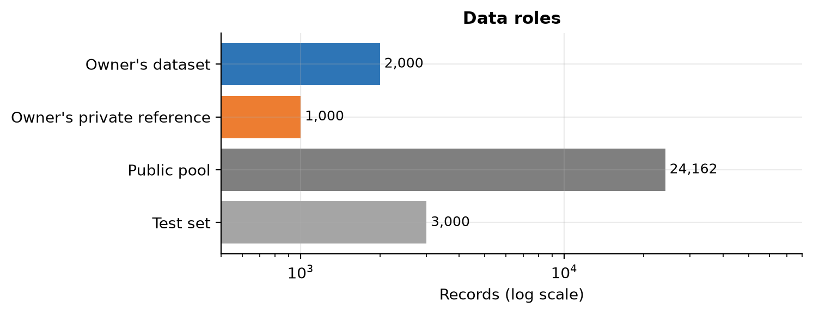
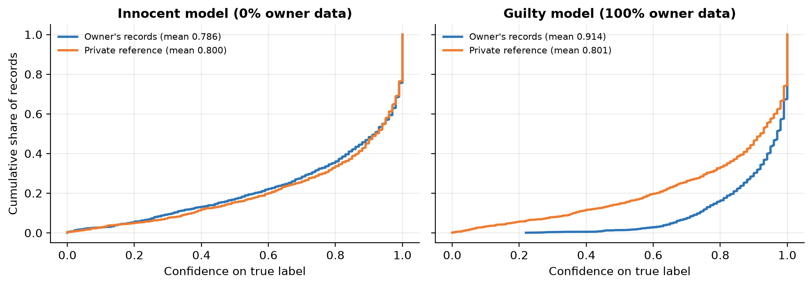
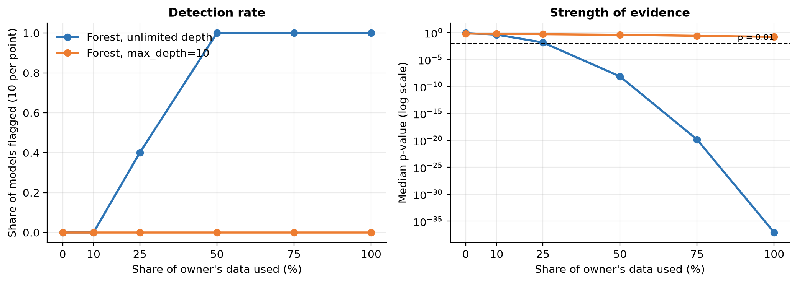
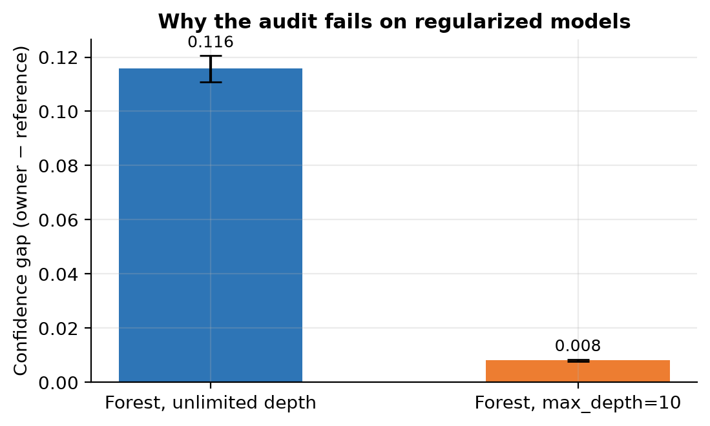
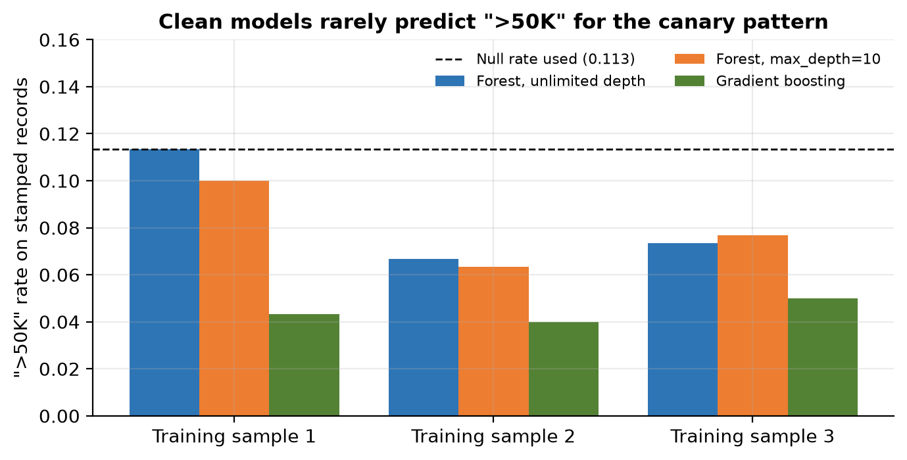
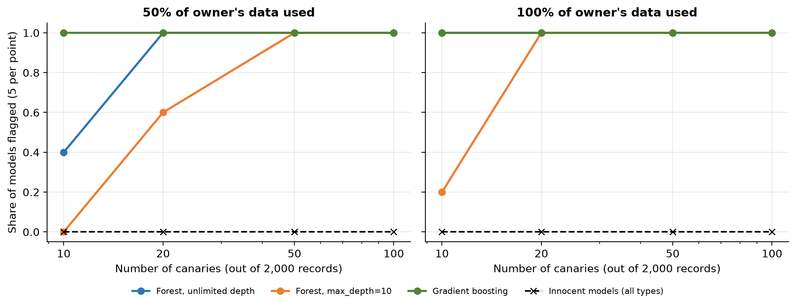
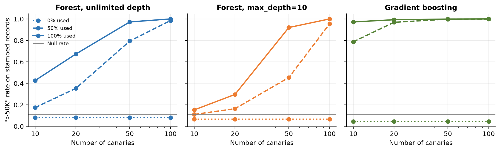
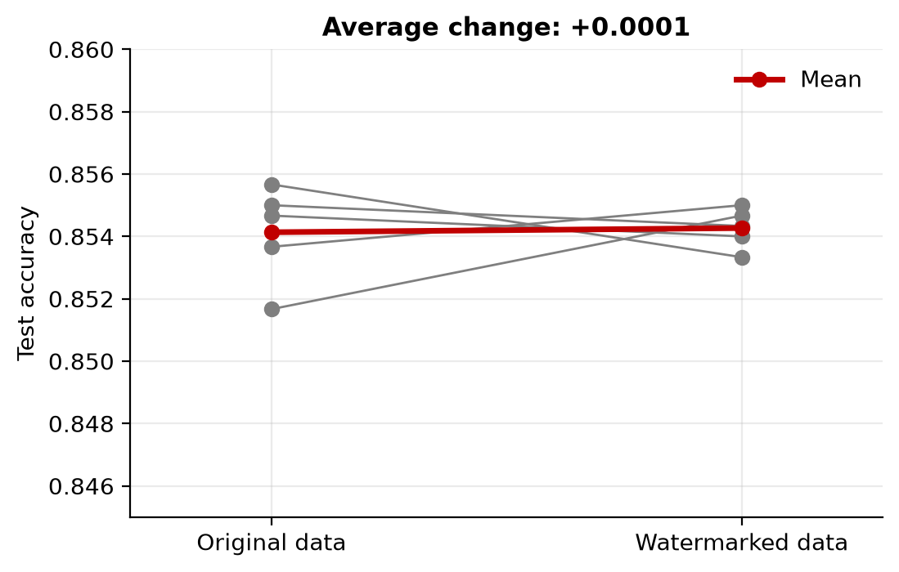
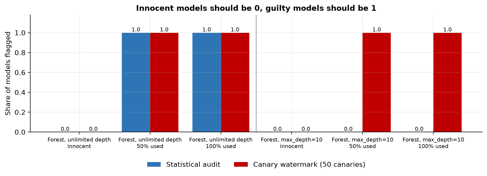

# Dataset Ownership Auditing: Detecting Unauthorized Use of Training Data with Statistical Tests and Canary Watermarks

A data owner suspects that someone trained a model on their dataset without permission. They can only query the model, not see its training data. Can they prove it? This project compares two ways to find out on the Adult Census dataset: a statistical audit that needs no changes to the data, and a canary watermark hidden in the data before it is shared.

**Author:** Aakash Tiwari, M.S. Cybersecurity, Rowan University

## Main results

| Result | Value |
|--------|-------|
| Statistical audit, unlimited forest, 50% or 100% of data used | 10 / 10 flagged |
| Statistical audit, regularized forest (max_depth=10), 100% used | 0 / 10 flagged |
| Canary watermark (50 canaries), all guilty models | 30 / 30 flagged |
| Innocent models wrongly flagged (both methods) | 0 / 80 |
| Accuracy change caused by the watermark | +0.0001 |

## Setup

| Part | Records | Who has it |
|------|---------|------------|
| Owner's dataset | 2,000 | The owner. The data that might be misused |
| Owner's private reference | 1,000 | Kept secret by the owner |
| Public pool | 24,162 | Used by suspects to train models |
| Test set | 3,000 | Used to measure accuracy |

A guilty model is trained on 8,000 public records plus 10% to 100% of the owner's dataset. An innocent model is trained on public records only.



## Method A: statistical audit

Compare the model's confidence on the owner's records with its confidence on the private reference records. If the model is clearly more confident on the owner's records (one-sided t-test, p < 0.01), it is flagged.



A guilty model is much more confident on the owner's records (0.914 vs 0.801). An innocent model treats both sets the same.



| Model | 0% (innocent) | 10% | 25% | 50% | 75% | 100% |
|-------|---------------|-----|-----|-----|-----|------|
| Forest, unlimited depth | 0 / 10 | 0 / 10 | 4 / 10 | 10 / 10 | 10 / 10 | 10 / 10 |
| Forest, max_depth=10 | 0 / 10 | 0 / 10 | 0 / 10 | 0 / 10 | 0 / 10 | 0 / 10 |



The audit only works when the model overfits. A regularized forest barely changes its confidence on the owner's records (gap 0.008 vs 0.116), so there is nothing to detect.

## Method B: canary watermark

Before sharing, the owner turns a few records into canaries with a secret pattern (age 17, 99 hours per week, capital loss of 1,234) and the label ">50K". To audit, the pattern is stamped onto 300 reference records. If the suspect model predicts ">50K" for them much more often than clean models do (binomial test, p < 0.01), it is flagged.



Clean models predict ">50K" for the pattern at most 11.3% of the time. That is the baseline.





| Canaries | Model | 0% (innocent) | 50% used | 100% used |
|----------|-------|---------------|----------|-----------|
| 10 | Forest, unlimited depth | 0 / 5 | 2 / 5 | 5 / 5 |
| 10 | Forest, max_depth=10 | 0 / 5 | 0 / 5 | 1 / 5 |
| 10 | Gradient boosting | 0 / 5 | 5 / 5 | 5 / 5 |
| 20 | Forest, unlimited depth | 0 / 5 | 5 / 5 | 5 / 5 |
| 20 | Forest, max_depth=10 | 0 / 5 | 3 / 5 | 5 / 5 |
| 20 | Gradient boosting | 0 / 5 | 5 / 5 | 5 / 5 |
| 50 | All three models | 0 / 15 | 15 / 15 | 15 / 15 |
| 100 | All three models | 0 / 15 | 15 / 15 | 15 / 15 |

With 50 canaries (2.5% of the owner's dataset), every guilty model was caught, including regularized models and models that used only half the data. No innocent model was ever flagged.

## Cost of the watermark



Test accuracy changed by +0.0001 on average across 5 models. The canaries did not hurt the data.

## Comparison



- The statistical audit needs no preparation, but only works on overfitting models that used a large share of the data.
- The canary watermark needs planning before sharing, but works across model types and regularization, with no false alarms and no accuracy cost.

## Limitations

- The canary pattern is unusual and could be removed by outlier filtering before training. Designing canaries that look natural is an open problem.
- The statistical audit uses only average confidence. A stronger membership score could make it more sensitive.
- Only tabular data and tree-based models were tested.

## Project structure

```
dataset_ownership_auditing.ipynb                   all experiments
figures/                                           9 figures saved by the notebook
Dataset_Ownership_Auditing_Documentation.docx      full project write-up
requirements.txt
setup_and_run.bat                                  one-click setup on Windows
```

## Run

```
pip install -r requirements.txt
jupyter notebook dataset_ownership_auditing.ipynb
```

On Windows you can also double-click `setup_and_run.bat`.

## References

- Shokri, Stronati, Song, Shmatikov. Membership Inference Attacks against Machine Learning Models. IEEE S&P 2017
- Maini, Yaghini, Papernot. Dataset Inference: Ownership Resolution in Machine Learning. ICLR 2021
- Becker, Kohavi. Adult. UCI Machine Learning Repository, 1996
